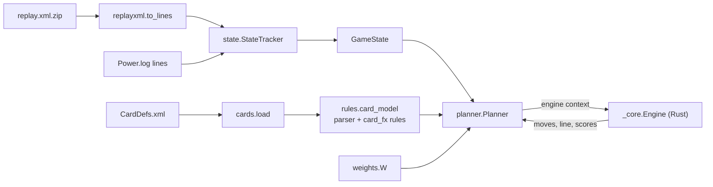

# Architecture

This page describes how a position travels from a game log to a searched line, and how the Rust core models
cards, triggers and the turn search. It also defines the terms the other pages use.

## Contents

- [Terminology](#terminology)
- [Data flow](#data-flow)
- [Module map](#module-map)
- [Positions](#positions)
- [Effect ops](#effect-ops)
- [Triggers](#triggers)
- [Deaths, auras and the end of the turn](#deaths-auras-and-the-end-of-the-turn)
- [Search and scoring](#search-and-scoring)
- [Self-play](#self-play)
- [Held-back cards](#held-back-cards)

## Terminology

All pages take the side of the player whose turn the engine searches. *I*, *me* and *my* refer to that
player; *the enemy* is the opponent.

| Term | Meaning |
| --- | --- |
| Position | One state of the game during my turn: mana, hand, both boards, both heroes. `S` in Rust and Python. |
| Unit | One minion on either board, `U`. |
| Card model | The compiled behaviour of one card, `Info`: its play modes, Deathrattle, aura, end-of-turn effects and triggers. |
| Op | One effect step, `Fx`, such as `dmg` or `summon`. A play mode is a list of ops. |
| Mode | One way to play a card. Choose One cards have several; the search tries each. |
| Rule | A hand-written JSON entry in `hsengine/card_fx/` that replaces parts of a parsed card model. See [RULES_FORMAT.md](RULES_FORMAT.md). |
| Engine context | The dict that `Planner` hands to the Rust core: the position, every card model and the weights. |
| Move | One attack, or one card play with its target and mode. `Act` in Rust. |
| Line | The moves of one turn in order, as a list of `Step`s. |
| Enemy reply | The greedy enemy turn the engine simulates after each candidate line. |
| Fast score, refined score | The position score the search orders moves by, and the score after the end of my turn, the enemy reply and an optional look at my next turn. |
| Corpus | The logged games that measure the engine. See [ACCURACY.md](ACCURACY.md). |
| Exact action, deterministic action | The two agreement measures. See [ACCURACY.md](ACCURACY.md#exact-and-deterministic-rates). |
| Fitted rule | A rule chosen because it lowers the number of wrong actions on the corpus, not because the card text says so. See [ACCURACY.md](ACCURACY.md#fitted-rules). |
| Real, modeled and invariant cases | The three kinds of per-card test case. See [TESTING.md](TESTING.md#per-card-suite). |
| Known miss | A real case the engine gets wrong, kept as a strict `xfail`. See [KNOWN_GAPS.md](KNOWN_GAPS.md). |

## Data flow

1. `StateTracker` reads game log lines and keeps a `GameState` from the local player's side: both boards,
   hands, heroes, weapons, mana and the keywords of every entity. `replayxml.to_lines` turns a zipped XML
   replay into the same log lines.
2. `rules.card_model` compiles each card in play into a card model. A regex parser reads the English card
   text; a hand-written rule replaces the fields it names ([RULES_FORMAT.md](RULES_FORMAT.md)).
3. `Planner` packs the position, the card models and the weights into the engine context and builds
   `_core.Engine` from it.
4. The Rust core lists moves, applies them and searches the turn. `Planner` converts the positions it returns
   into the Python named tuples `S` and `U`.

Self-play takes a different entry point: `selfplay.table` compiles every card of the decks once, and the Rust
`game` module plays both sides without Python in the loop ([Self-play](#self-play)).

The Rust crate has no I/O. The Python package reads only the card database and its own rule files; the
measurement tools in `tools/` are the only code that reads replays or logs.

## Module map

### Rust core (`engine/src`)

| Module | Responsibility |
| --- | --- |
| `state` | Position types (`S`, `U`, `T`, `Act`), effect ops (`Fx`, `OPS`), keyword bits (`K_*`), string-to-code tables |
| `planner` | `Planner`: the card models of one turn and the bookkeeping the rules share during the search |
| `moves` | Legal moves: every attack and every affordable card play with its targets and modes |
| `effects/` | `Planner::apply` and the op groups: `damage`, `summon`, `buffs`, `removal`, `cards`, `targets`, `triggers` |
| `reply` | The greedy enemy reply and the removal and board-clear risk penalties |
| `eval` | Position scoring: unit values, heroes, hands, threat, next-turn gain |
| `search` | Depth-first turn search with a candidate heap |
| `weights` | `Wt`, the evaluation weights, one field per key of the Python `W` |
| `game/` | Whole games for self-play; `setup` builds each turn's `Planner`, `lookahead` adds rollouts and MCTS |
| `lib.rs` | `run_search` (search, then re-rank) and `replay` (play a found line again) |

### Python package (`hsengine`) and bindings (`python/src`)

| Module | Responsibility |
| --- | --- |
| `state.py` | Game log lines to `GameState` (`StateTracker`, `Ent`) |
| `replayxml.py` | Zipped XML replays to game log lines |
| `cards.py` | Card database loader (`load`, `Card`, `CardDataError`) and minion type masks |
| `rules.py` | Card text to ops, hand-written rules, `card_model` |
| `planner.py` | `GameState` to the engine context; Python views of engine positions; `Planner.search` |
| `weights.py` | The hand-tuned evaluation weights `W` |
| `selfplay.py` | Deck tables and `run` for self-play |
| `check.py` | Replays one logged action through the engine; shared by the tools and the per-card tests |
| `python/src/lib.rs` | The `_core` extension: engine context to Rust types and back |

`tools/` holds the measurement scripts (`sim_check.py`, `eot_check.py`), the fixture exporter
(`export_fixtures.py`), the known-miss triage (`triage_xfail.py`) and the cache reader they share
(`cache.py`).

## Positions

`S` holds one position: mana, the hand (as card uids), my units and the enemy's, both heroes' health and my
armor, my hero's attack and weapon, Death Knight corpses, the minions that died and the cards drawn and played
this turn. `U` holds one unit: uid, attack, health and maximum health, its keywords, attacks left, a temporary
attack change, its minion type bits and the counters some rules need.

Positions are plain values. The search copies `S` on every move, and no code in the core changes a position
in place once a move has returned it.

## Effect ops

A card does what its ops say. Each op carries an op name, three numbers (`n`, `a`, `h`), keywords, a target
kind, a condition and an area scope. [RULES_FORMAT.md](RULES_FORMAT.md#op-fields) lists the fields and their
values.

The Python side passes names as strings. The core turns them into small integer codes once (`op_code`,
`tgt_code`, `cond_code`, `scope_code` in `state.rs`) and dispatches on the codes. `state::OPS` lists the 80 op
names; an op code is an index into that list.

`moves` asks `effects::targets` for the legal targets of a card's first targeted op, and `Planner::apply`
runs the ops of the chosen mode in order. Each op resolves fully, including deaths, Deathrattles and
triggers, before the next one starts.

An op name the core does not know does nothing. A card with a sentence the parser cannot read still plays,
and its `pv` field carries a static value for the part the engine cannot play out.

## Triggers

A trigger is an `(event, ops, filter)` triple on a card model. The core fires it from the move or effect that
causes the event.

| Code | Event | Fires when |
| --- | --- | --- |
| 1 | `hero_attack` | My hero attacks. Weapon triggers use this event too. |
| 2 | `spell` | I cast a spell. |
| 3 | `minion_play` | I play a minion. The filter `battlecry` limits it to Battlecry minions. |
| 4 | `power` | I use my hero power. |
| 5 | `draw` | I draw a card. |
| 6 | `self_attack` | This minion attacks. |
| 7 | `ally_grew` | Another friendly minion gains stats. |
| 8 | `healed` | A friendly character is healed. |
| 9 | `friendly_died` | A friendly minion dies. |
| 10 | `self_damaged` | This minion takes damage. |

## Deaths, auras and the end of the turn

Deaths resolve in `effects::summon`. The core fires death triggers, removes the dead minion's aura, returns
a Reborn minion with 1 health and runs the Deathrattle, which summons minions or adds cards to my hand.

An aura (`Info.aura`) applies when its card is played and comes off when the card dies. `moves` recomputes
adjacency auras after every move.

End-of-turn effects run when my turn ends, before the enemy reply. Minions marked doomed die at that point.

## Search and scoring

`Planner.search` in Python calls `run_search` in `lib.rs`, which works in two passes.

1. **Walk.** `Search::dfs` visits every line of my turn, best-scored child first, and skips positions it has
   seen before (by position key). `moves` tries only one of several identical units. Every visited position
   competes for a fixed-size heap of the best end positions by fast score. If the walk finds lethal, the
   shortest lethal line wins and the second pass is skipped.
2. **Re-rank.** Without lethal, every candidate gets the refined score: the core plays the end of my turn and
   the enemy reply (`reply::enemy_turn`). The 12 best candidates also get a small search of my next turn
   (`eval::next_turn_gain`). The best refined score wins.

The enemy reply is one plausible turn, not a search. It plays announced random pings, then attacks with every
enemy minion that can, strongest first, each taking the trade that is worst for me or going face, then swings
the enemy weapon and uses direct hero-power damage. `reply::removal_risk` and `reply::aoe_risk` add penalties
for what the enemy hand might still hold.

A node limit and a time budget bound the walk. `Planner.search` defaults to 40 candidates, 60,000 nodes and
0.6 seconds. `replay` plays a found line again step by step.

The scores come from hand-tuned weights in `hsengine/weights.py`. The Rust `Wt` struct has one field per key
and ignores keys it does not know.

## Self-play

The `game` module plays whole games between two decks: draws, mana, fatigue, a simple mulligan and hidden
hands. Each turn, `game::setup` builds a `Planner` for the player to move and runs the same turn search with
the hand-tuned weights. A side can replace the search's pick with a look-ahead over whole turns
(`game::lookahead`): Monte Carlo rollouts with the hidden cards re-dealt, or a tree search (MCTS) over both
players' turns. Both run on copies of the game.

From Python, `selfplay.run` takes a list of `selfplay.Deck`s and returns the result of each game. It also
accepts weight overrides for one side, which makes it the tool for comparing weights or search settings.

## Held-back cards

Some effects set a card aside when a draw hits a full hand, instead of burning it. The log shows this as
copies of the card in the SETASIDE zone, created by the effect's enchantment (`JAIL_509e`). Each copy returns
to the hand once a slot frees up.

`StateTracker` counts these copies in `GameState.held_back`, and `check.outcome` adds
`min(held_back, 10 - hand)` cards to the predicted hand size. `Planner` carries the count only when the hand
starts the position full (10 cards). That condition is a fitted rule ([ACCURACY.md](ACCURACY.md#fitted-rules)).
The search itself does not model held-back cards.
